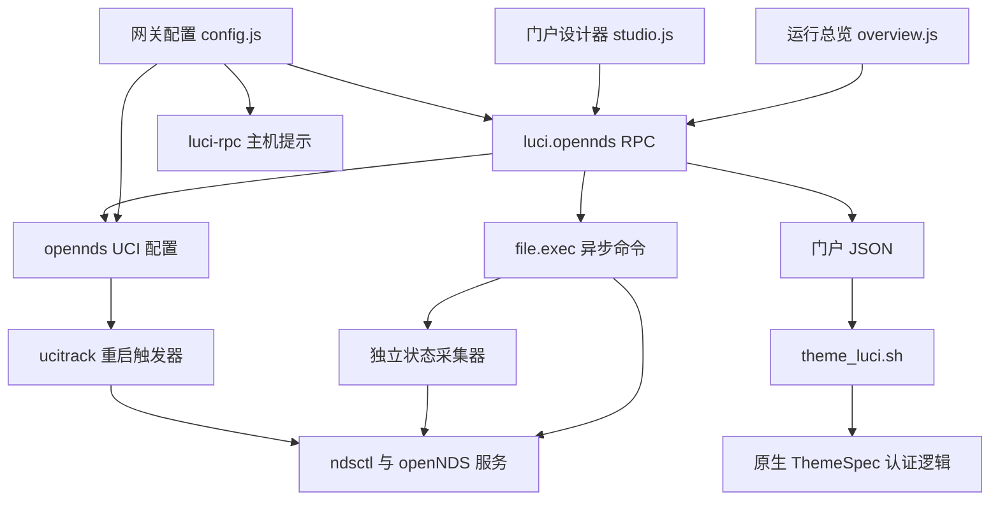

# luci-app-opennds 多维度代码优化与精简分析报告

> 本文保留重构前的分析快照。随后根据“项目尚未使用、无需旧版兼容”的新约束实施了重构，当前结构和验证结果见[重构说明](refactoring.md)。

分析日期：2026-11-06（Asia/Singapore）
分析对象：`luci-app-opennds/` 当前本地文件快照
工作范围：源码审查、现有测试、隔离实验和报告编写；未实施生产代码重构。

## 1. 结论与建议

**可以用更少的代码实现相同功能。最值得处理的是总览页的重复组件和设计器的字段定义，后端则应以保留错误语义和配置保护为前提做局部整理。**

当前插件的体量较小，职责边界基本清楚。精简应围绕已有重复点展开，无需引入组件框架、通用表单引擎或新的配置文件格式。

| 维度 | 判断 | 建议 |
| --- | --- | --- |
| 前端重复逻辑 | 存在明确、可定位的重复 | 优先提取按钮、卡片外壳、普通字段及统计函数 |
| 网关配置表单 | 大部分代码描述不同业务规则 | 仅整理同构数值项，保留 FAS 状态转换与主机提示校验 |
| 后端 RPC | 防御性分支占有一定篇幅 | 保留返回码、异步边界和部分成功语义，避免一刀切包装 |
| 门户运行开销 | 重复解析同一个 JSON 文件 | 可批量提取字段；提速幅度须在目标设备测量 |
| 状态采集 | 可减少一次解释器启动和 RPC 执行请求 | 作为独立的中风险优化，保留两路采集的错误隔离 |
| 算法效率 | 信任名单合并存在嵌套查找 | 大列表场景可加 MAC 索引，允许为性能增加少量代码 |
| 测试保障 | 已有较广的逻辑回归与专项原生测试 | 本轮 98 项 Node 测试通过；浏览器和路由器行为仍需验证 |
| 减重比例 | 尚无完整重构原型可供计量 | 不承诺固定百分比或“净减 420 行” |

较确定的机会是消除数十行重复样板；能否净减上百行，需要用实际补丁验证。减少源码行数、缩小安装包和降低运行开销应分别计量。

## 2. 取证范围与统计基线

### 2.1 方法与限制

本报告检查了全部生产文件、四个测试文件、翻译与示例入口，并追踪仓库外层构建流程。官方 openNDS 源码仅作为接口背景，不纳入插件精简目标。

当前目录未发现可用于核验分支和提交的 Git 元数据，因此本报告针对本地文件快照，不声称对应某个已提交版本。编写前记录了插件和工作流共 27 个已有文件的 SHA-256，交付前复核其内容。

源码中可直接确认的事实、Node 模拟实验、历史构建记录和待实机测量的预期，分别标明，不相互替代。

### 2.2 生产文件清单

物理行数包含注释和空行；非空行数排除纯空白行，但仍包含注释。两者均不是解析语言后得到的逻辑代码行数。文件大小按实际字节统计。

| 文件（相对插件目录） | 物理行 | 非空行 | 字节 | 主要职责 |
| --- | ---: | ---: | ---: | --- |
| `htdocs/luci-static/resources/view/opennds/overview.js` | 514 | 460 | 20,083 | 状态、客户端、日志、服务重启和配置升级入口 |
| `htdocs/luci-static/resources/view/opennds/config.js` | 324 | 286 | 15,079 | 网关、FAS、超时、配额和访问控制表单 |
| `htdocs/luci-static/resources/view/opennds/studio.js` | 307 | 269 | 12,676 | 门户文案编辑、保存和手机预览 |
| `root/usr/share/rpcd/ucode/opennds.uc` | 470 | 445 | 19,145 | 八个 RPC 方法及配置、持久化、进程辅助逻辑 |
| `root/usr/libexec/luci-opennds-status.uc` | 42 | 38 | 1,590 | 在 rpcd 外读取并精简 ndsctl 输出 |
| `root/usr/lib/opennds/theme_luci.sh` | 83 | 76 | 3,283 | 门户 HTML 和原生认证流程衔接 |
| `root/etc/uci-defaults/80_luci-app-opennds` | 29 | 24 | 1,349 | 安装初始化和 ucitrack 兼容 |
| `root/usr/libexec/luci-opennds-restart` | 3 | 3 | 124 | 配置应用后的重启触发器 |
| `root/usr/share/luci/menu.d/luci-app-opennds.json` | 46 | 46 | 839 | 菜单与视图入口 |
| `root/usr/share/rpcd/acl.d/luci-app-opennds.json` | 22 | 22 | 570 | 读写权限声明 |
| `root/usr/share/ucitrack/luci-app-opennds.json` | 4 | 4 | 71 | JSON 格式配置变更触发器 |
| `root/lib/upgrade/keep.d/luci-app-opennds` | 1 | 1 | 31 | 门户 JSON 的 sysupgrade 保留声明 |
| `Makefile` | 17 | 13 | 586 | 包定义及运行依赖 |
| **合计：13 个文件** | **1,862** | **1,687** | **75,426** | **约 73.7 KiB 源文件** |

三个前端文件共 1,145 个物理行，约占生产文件物理行数的 61.5%。这是优先检查前端重复逻辑的依据，不能直接解释为同等比例的运行资源消耗。

| 辅助资产 | 文件数 | 物理行 | 非空行 | 字节 |
| --- | ---: | ---: | ---: | ---: |
| 自动化测试 | 4 | 1,576 | 1,458 | 92,082 |
| 翻译文件 | 2 | 1,045 | 699 | 29,125 |
| 初始配置示例及说明 | 4 | 197 | 165 | 9,029 |
| 插件 README | 1 | 95 | 61 | 7,755 |

上述辅助资产不纳入生产代码减重分母。许可证也不属于精简目标。

## 3. 功能地图与“相同功能”的验收边界



“相同功能”应包含成功路径、错误路径、持久化效果和界面表现：

| 功能 | 必须保持的行为 |
| --- | --- |
| 运行总览 | 每 5 秒刷新；停止时清空旧客户端；RPC 失败显示不可用；日志失败显示错误 |
| 客户端管理 | 状态、流量单位、时长、信任名单合并与按钮可用条件保持一致；操作后刷新并恢复控件 |
| 网关配置 | 字段默认值、校验、隐藏字段保留、主机提示降级和 FAS 端口往返恢复保持一致 |
| 配置升级 | 仅处理可确认的 v11 旧配置；备份原字节；提交或验证失败尝试恢复；重启失败报告部分成功 |
| 门户设计器 | 七个字段、已有文案、颜色与图标、实时预览、空值处理和保存通知保持一致 |
| 实际门户 | 保持 HTML 转义、颜色和图标白名单、表单参数，以及原生令牌、授权和日志流程 |
| 安装与升级 | 不覆盖已有守护进程配置和设备密钥；保留 ucitrack 兼容及门户 JSON 升级保留 |
| 外部接口 | 保持 RPC 方法名、参数、返回字段、读写 ACL，以及 UCI 和门户 JSON 的既有格式 |

将轮询改成 10 秒、删除手机外框、删去错误提示，或减少配置项，都会改变以上行为，不能计入“同功能精简”。

## 4. 前端代码：主要精简机会

### 4.1 总览页：优先复用已有行为，保持结构差异

依据：[overview.js][overview] 的 `render()`、`refreshClientsNow()`、`renderClientRows()`。

**A. 客户端状态统计重复，适合提取纯函数。**

144–150 行与 336–344 行分别统计已认证和待认证数量。可复用一个 `countClientStates(list)`，继续依赖现有 `parseClientState()`，并明确 Trusted、Blocked 和未知状态不计入这两类。该改动主要减少维护两份逻辑的成本，不改变遍历复杂度。

**B. 四种客户端操作按钮重复，适合小型工厂函数。**

427–473 行重复创建按钮、绑定点击处理并加入操作单元格。`runClientAction()` 已经统一了禁用、错误通知、刷新和恢复，因此只需补齐按钮构建层的复用。

可将动作、标签、样式类、成功文案与通知级别传给工厂；调用处继续清楚地保留显示条件。必须保持 Untrust 当前与其他按钮不同的样式，以及 `duration=-1` 的调用语义。循环生成时也应避免多个闭包捕获同一个可变动作变量。

**C. 卡片可以共享外壳，内部内容不宜强行统一。**

152–220 行中外层边距、圆角、标题样式有重复，但主值布局、提示颜色和快捷操作区域不同。建议只抽取外壳或少量公共样式；用一个带大量可选参数的万能卡片替代所有结构，可能增加理解成本。

**D. 刷新逻辑中存在可直接整理的小重复。**

- 309–326 行已有局部 `update()`，328–344 行又进行多次查询和赋值，可统一引用方式。
- uptime 已在 321 行更新，333–334 行又尝试更新，可保留一次完整更新。
- 四处全局 `document.getElementById()` 回退可评估移除；应先确认视图内部查询和测试替身均满足要求。
- 当前文件中的 `dom` 导入和 `self` 变量未被使用，可清理；不能将此解读为必然减少浏览器网络请求。

表格的文本单元格也可用局部辅助函数构建，但状态徽章和操作单元格具有不同职责。不建议将所有单元格变成复杂描述对象，仅为了缩短函数外观。

### 4.2 门户设计器：普通字段元数据化，特殊控件显式保留

依据：[studio.js][studio] 的 63–151、212–221、267–295 行。

七个字段在控件创建、保存 payload 和事件绑定中重复出现。适合采用一个固定字段列表，复用名称集合和普通文本字段构建，并为颜色、图标和多行条款保留明确分支。

可以复用的部分包括标签样式、文本输入宽度、字段收集、输入事件注册，以及图标值到显示文字的映射。无需为七个字段建立通用表单框架。

重构时有四个容易遗漏的细节：

1. `textarea` 应使用文本子节点或 `.value` 属性赋值初始化；不能仅设置 HTML `value` 属性。LuCI 的属性处理最终调用 `setAttribute()`。[官方实现](https://github.com/openwrt/luci/blob/openwrt-24.10/modules/luci-base/htdocs/luci-static/resources/luci.js)
2. 图标选择绑定 `change`，普通输入绑定 `input`；不能无条件替换成同一种事件。
3. 保留条款高度、Footer 间距、字段顺序和空 Footer 的当前初始回退规则。
4. 翻译标签继续使用可被提取的字面量 `_('...')`；不把标签拼成动态翻译键。

手机外框、状态栏、浏览器栏属于当前界面功能。删除它们会改变外观；将内联样式移到 CSS 文件只是重新组织代码，是否减重应按 JS 与 CSS 的总量计算。

### 4.3 网关配置：局部整理，避免把业务分支当作重复

依据：[config.js][config]。

196–234 行的超时、限速与配额项存在同构的 `taboption + datatype + default` 模式。可用小型辅助函数或数值项列表减少重复赋值，保持每个字段的标题、说明和默认值可直接阅读。

以下两块不建议为减少行数而压缩：

- **247–270 行主机提示：**承担 MAC 校验、大小写不敏感去重、已保存拼写保留、主机名与多格式 IPv4/IPv6 合并，以及 DOM 文本安全。换成 `map/filter` 并不会自然减少规则数量，也可能增加中间数组。
- **292–320 行 FAS 模式转换：**处理旧模式、新模式、可见表单值、隐藏配置值和外部端口备份。三元表达式无法替代这些状态转换。尤其不能把重复保存本地模式产生的内部 `443` 端口覆盖到外部端口备份中。

## 5. 后端 RPC：压缩样板的收益小于保留语义的价值

依据：[opennds.uc][backend]。

### 5.1 保留当前进程执行边界

`execute()` 通过 `bus.defer('file', 'exec', ...)` 异步调用，并统一处理 ubus 错误、无效响应与命令退出码。`completed` 防止重复完成，shell 包装用于保留信号退出后的错误状态。

把这些逻辑替换为 rpcd 主循环中的同步 `popen()`，虽然可能减少代码，却会改变并发与响应行为，不符合本次目标。

### 5.2 合并状态采集是可选的结构优化

运行状态路径目前先检查 PID，再串行启动两次采集器，分别读取 JSON 和文本元数据。可以让一个采集器完成两路读取，返回内部聚合对象。

这会减少一次 `file.exec`、一次 ucode 启动及一层回调，但仍需要两次 `ndsctl`。元数据解析也仍然存在，只是可以移入采集器；必须按后端与采集器两个文件的净变化评估代码量。

合并必须保留：

- JSON 失败后仍可返回元数据，元数据失败时仍可返回客户端。
- 守护进程存活时采集失败，仍显示运行并报告错误。
- 配置中的网关字段作为现有回退值。
- 原来两段各 5 秒等待的时间预算和总体请求期限；不能直接给合并后的全部工作套一个 5 秒超时。
- 子进程精简后再进入 rpcd 输出缓冲区的边界。

因此该项风险为中，净行数可能减少、持平或增加；不适合和前端去重捆绑交付。

### 5.3 只清理有充分依据的后端小重复

`get_log` 在 332–335 行已对失败返回，337 行再检查 `code == 0` 没有必要，可去掉这层成功分支。

`html_escape()` 与 `html_unescape()` 共承担少量字符转换，当前顺序清楚。查表或正则回调不保证更少字节或更高性能，也会增加 ucode 兼容性验证工作，优先级低。

配置升级重新生成计划、保存门户在异步检查后重新读取配置与页面大小限制，都发生在外部状态可能变化的边界，不应按表面重复删除。RPC 的“失败”“已保存但未应用”“已升级但重启失败”也不应压成单一成功布尔值。

## 6. 运行开销：分清命令调用、RPC 次数和实际性能

### 6.1 门户 JSON 可以单次解析，转义仍需保留

依据：[theme_luci.sh][theme] 的 `header()` 与 `continue_form()`。

| 当前调用范围 | jsonfilter | sed | cat |
| --- | ---: | ---: | ---: |
| 一次 `header()` | 7 | 5 | 1 |
| 一次 `continue_form()` | 0 | 1 | 1 |
| 两者各调用一次 | 7 | 6 | 2 |

这是源码可确认的外部程序调用次数，不包含原生脚本的其他操作，也不等于所有 fork 次数：管道与命令替换还可能建立 shell 子进程。

`jsonfilter` 支持一次使用多个 `-e VAR=@.field` 导出变量。其官方字符串输出使用单引号引用，并处理值中的单引号，可以用于固定变量名的 shell `eval`。[官方实现](https://github.com/openwrt/jsonpath/blob/master/main.c)

在继续使用现有五次文本转义的方案中，`header()` 的 JSON 解析可从 **7 次降为 1 次**，即少调用 6 次 `jsonfilter`；五次 `sed` 和 HTML 输出仍然存在。

保持等价还需要在读取前初始化变量，并保持缺失字段、空值、坏 JSON 和多行条款的当前处理。官方导出在未匹配字段时不产生赋值；若直接 `eval` 而不初始化，可能保留旧变量值。不能以删除 HTML 转义换取更少进程。

这项优化减少重复解析的方向明确，具体 TTFB、CPU 和内存收益尚未实测。建议先在目标设备比较相同内容下的响应耗时、并发访问和内存峰值。

### 6.2 暂不推荐增加可执行的门户 .env 缓存

当前 JSON 是设计器和门户共享的数据来源。另生成 `.env` 后会引入两个文件的同步关系，并使文案数据成为可被 shell 执行的内容。

需要额外解决 shell 引用与 HTML 转义、原子更新、缺失或过期缓存、手工编辑 JSON、旧版本升级，以及 sysupgrade 保留。单个文件的原子 rename 也不能让两个独立文件形成原子事务。

它可能降低读取开销，但尚无证据说明这些复杂度优于单次 JSON 解析，不作为本轮精简的默认方向。

### 6.3 总览轮询的调用基线

依据：[overview.js][overview] 284–345、500–506 行及 [opennds.uc][backend] 的 `status`、`get_log`。

| 一次刷新 | 守护进程正常运行 | 守护进程已停止 |
| --- | ---: | ---: |
| PID 检查 | 1 次 file.exec | 1 次 file.exec |
| 两路状态采集 | 2 次 file.exec | 0 |
| 版本与配置检查 | 0 | 1 次 file.exec |
| 日志读取 | 1 次 file.exec | 1 次 file.exec |
| **合计** | **4 次 file.exec** | **3 次 file.exec** |

这些数值不包括用户主动操作、超时和异常恢复，也不是总进程数：外层有 shell 和 timeout，采集器内部还通过 `popen()` 调用 `ndsctl`。

合并状态采集后，正常运行的一次刷新可从 **4 次 file.exec 降为 3 次**。仅据这一点无法计算 CPU 降幅。

页面已在容器断开时移除轮询，也会在重复 render 时替换旧回调。浏览器标签隐藏和容器断开是不同事件；暂停隐藏标签轮询需要明确恢复策略。将周期改成 10 秒则直接改变刷新时效，两者均应单独决策，不计入本次同功能重构。

## 7. 算法、内存与包体积

### 7.1 信任名单合并可由嵌套查找改为索引查找

`clientArray()` 对每个 trusted MAC 调用 `list.find()`，对初始 N 条客户端与 T 条信任记录，查找开销可达到 O(NT + T²)，因为未出现的信任记录还会追加进列表。常见两者重叠场景主要体现为 O(NT)。

增加按小写 MAC 建立的索引，可将查找改为通常的 O(N + T)，代价是 O(N + T) 的额外索引空间和少量代码。索引应使用无原型对象，并保留原列表顺序、原 MAC 拼写和“首次匹配记录”的行为。

本轮在内存中执行了索引方案，与原函数比较四组合成输入，覆盖空输入、无效记录、大小写重复、信任项重复、追加记录及显式 MAC；结果一致，输入未被修改。这是局部实验，尚未证明完整重构或真实浏览器收益。

这项收益发生在管理端浏览器。它不直接降低路由器状态采集进程的 CPU 消耗。

### 7.2 状态精简避免传输大字段，但没有提供无限规模保证

采集器先 `pipe.read('all')`，再解析 JSON 并保留所需字段。因此它降低的是返回 rpcd 的数据量，仍需要在子进程中容纳完整原始输出和解析对象，不能认为原始数据内存开销消失。

本轮用生产采集器逻辑的 Node 替身执行环境，扩展既有测试样本得到：

| 合成客户端数 | 原始 JSON 字节 | 精简输出字节 | 相对 262,144 字节阈值 |
| --- | ---: | ---: | --- |
| 1,000 | 924,717 | 176,718 | 低于阈值 |
| 2,000 | 1,850,763 | 354,764 | 高于阈值 |

2,000 条超出了配置界面当前允许的 1,000 上限；该实验用于说明精简不是总大小硬限制，不据此判定当前支持范围存在故障。输出大小还取决于字段内容和 trusted 列表长度。

官方 rpcd 中，输出缓冲上限为 256 KiB，缓冲满会调度错误回复；不能由超限直接推导为 rpcd 崩溃。[官方实现](https://github.com/openwrt/rpcd/blob/master/file.c)

若未来扩大支持规模，应另行设计分页、硬上限或更紧凑的数据契约；这些会涉及新行为，不作为本轮删代码的捷径。

### 7.3 源码行数不等于安装包大小

现有本地历史构建日志显示打包时运行 `jsmin`。因此删除空行、注释或把多行压成一行，对该构建路径的最终 JS 通常没有相应收益。

可追溯的历史记录为 `artifacts/run-42039236983/`：构建信息记录插件提交 `195ca745e4f9161500a11f242d46c66a53f91c9f`，插件 IPK 为 20,552 字节；该记录不等于本轮构建，也未绑定到当前文件快照。

后续应同时比较生产文件总行数、源码字节、包内 JS 字节与最终包大小。引入独立 CSS、共享模块或渲染库时，要把新增文件及依赖一起计入。

## 8. 安全、兼容性和持久化边界

应保持保护行为，而非禁止修改某个函数的任何一行。

| 边界 | 当前依据 | 重构约束 |
| --- | --- | --- |
| 配置升级备份 | `write_exclusive`、`backup_config` 使用独占创建和 0600 权限 | 保留失败可恢复、备份不覆盖和敏感文件权限 |
| 迁移合法性 | `configuration_plan` 检查版本、段数量、名称冲突、待提交修改和自定义 BinAuth | 不扩大自动迁移范围 |
| 原子替换 | 保存门户检查 write、close、rename；恢复配置使用临时文件 | 不改为直接截断目标文件；不能宣称已有完整断电耐久保证 |
| 部分成功 | 门户文件、UCI 提交、重启具有不同失败结果 | 不把已落盘或已升级状态伪装成全部回滚或全部成功 |
| 输出安全 | HTML 转义、颜色和图标白名单、gatewayname 单引号兼容 | 保留各自上下文的转换；shell 引用不能替代 HTML 转义 |
| 敏感信息 | status 返回网关和客户端所需字段 | 不为“复用配置对象”把 faskey 等配置整体返回浏览器 |
| 输入边界 | MAC 格式、动作白名单、认证时长、字段类型与字节长度 | 不放宽为任意命令、路径或泛化参数透传 |
| 平台兼容 | v11 行为、POSIX ERE、SDK jsmin、ucode 文件 API 差异 | 在原生环境和实际打包文件上验证 |
| 安装兼容 | UCI 与 JSON 两种 ucitrack、权限修复、sysupgrade keep 文件 | 不因代码少或看似重复而删除 |

现有原子替换代码没有显式文件及目录 fsync。它保护写入失败时的替换过程，不能只凭 `close + rename` 承诺任意突然断电后的数据耐久性。本报告也不将增加耐久机制混入同功能精简范围。

ACL、菜单及安装文件本身已很短，潜在节省很小。设备选择器等组件可能间接使用权限，不应只凭插件中没有直接 RPC 调用就删除 ACL 项，更不能以通配权限替代显式清单。

## 9. 测试证据与缺口

### 9.1 本轮实际执行

在插件目录运行：

```sh
node --test --test-reporter=spec tests/regression.test.cjs tests/workflows.test.cjs
```

结果：**98 项通过，0 失败，0 跳过**；其中业务回归 95 项、工作流测试 3 项。Node 版本为 `v24.21.0`。

测试运行于 Windows，Shell 检查使用 Git Bash。工作流测试在临时目录创建本地仓库及远端替身，未触发真实发布或向远端服务推送。

此外执行了前述 MAC 索引等价实验和状态输出大小实验，均未修改生产文件。

### 9.2 已有测试应如何解释

| 层次 | 已有能力 | 证据边界 |
| --- | --- | --- |
| Node 业务回归 | 前端状态、错误恢复、配置转换、文件故障和采集逻辑 | DOM、RPC、UCI、文件系统与进程多为替身 |
| Shell 测试 | 真正执行模板及安装脚本的受控路径 | jsonfilter、原生认证脚本和系统命令存在替身 |
| 原生 ucode 专项 | 真 UCI、真文件系统和权限行为 | 进程执行仍被替换；不能证明真实 rpcd、守护进程与防火墙联动 |
| SDK 和包内回归 | 工作流检查打包后的视图语法、回归结果和包内容 | 本轮没有执行 SDK 构建 |
| 浏览器和路由器 | 需要真实控件、主题样式和访客设备认证 | 本轮未执行 |

Node 前端替身的 `addEventListener()` 为空方法，且没有浏览器布局能力。现有 95 项通过不能证明字段事件、CSS、焦点和视觉完全不变，也不能据测试数量断言行或分支覆盖率。

本轮未找到可直接使用的本地 ucode 命令，WSL 枚举返回访问拒绝，因此没有重新执行两项原生专项。历史构建目录中存在专项通过日志，但它们只能证明相应历史构建。外层构建流程已配置原生测试和包内视图回归，后续应保留这些检查。

### 9.3 实施各项优化时的针对性验证

| 优化项 | 至少验证 |
| --- | --- |
| 统计与按钮工厂 | 各状态的数量及按钮集合；动作参数、不同按钮闭包、失败恢复与操作后刷新 |
| 设计器字段复用 | 七字段加载和保存；多行条款；空 Footer；颜色与图标事件；字段顺序及手机预览外观 |
| 主机提示或 FAS 整理 | MAC 拼写与去重；异常提示降级；三种本地模式反复保存及切回外部模式；校验失败不改端口 |
| JSON 批量读取 | 真 jsonfilter 导出；引号、反引号、美元符号、多行文本、缺字段、坏 JSON、默认值与 HTML 输出 |
| 状态采集合并 | 两路分别失败、超时、异常 JSON、元数据回退、1,000 客户端输出和异步请求并发 |
| 打包相关调整 | clean build、包内容、jsmin 后脚本回归，以及目标 ucode 环境检查 |

对命令顺序等白盒断言，可以随内部实现调整；“采集必须发生在 rpcd 外”“失败必须可见”“配置可恢复”等契约断言应继续保留。

## 10. 建议实施顺序与停止条件

| 顺序 | 建议范围 | 预期收益 | 风险 | 净代码量预期 |
| --- | --- | --- | --- | --- |
| 1 | 总览页按钮工厂、统计复用、重复更新与无用变量 | 重复逻辑减少，行为更容易一致维护 | 低至中 | 减少 |
| 2 | 设计器普通字段复用、payload 与事件注册、图标映射 | 七字段定义更集中 | 中，主要是控件与视觉等价 | 减少 |
| 3 | 网关数值项的小型辅助函数 | 减少同构赋值 | 低至中 | 小幅减少或持平 |
| 4 | 门户一次性 JSON 提取 | 少调用 6 次 jsonfilter | 中，需真工具和门户验证 | 可能持平或增加 |
| 5 | 状态采集器合并 | 正常刷新少一次 file.exec 和 ucode 启动 | 中 | 未定 |
| 按需 | MAC 索引 | 降低大名单的浏览器查找复杂度 | 低至中 | 可能增加 |

前两步完成即可形成独立交付。只有出现测试失败、新的行为差异或明确测量需求，才扩大修改范围。

每一步的完成条件是：

1. 功能与错误行为满足第 3 节契约，未增加无关接口或运行依赖。
2. 统计全部修改及新增生产文件的净变化，不能用搬文件、删注释或挤行制造减重。
3. 本项针对性验证和现有回归通过；涉及实际控件、Shell、ucode 或打包时完成对应层次验证。
4. 性能结论附目标设备测量；没有测量时只报告调用次数或复杂度变化。

不建议将“净减某个固定百分比”作为验收目标。更适合的目标是：重复逻辑只有一个维护点，原有保护可被验证，文件总量和运行开销均有可复核证据。

## 11. 复核入口

主要文件与符号：

- [overview.js][overview]：`clientArray`、`render`、`refreshClientsNow`、`runClientAction`、`renderClientRows`。
- [studio.js][studio]：`render`、字段控件、保存 payload、`updateSimulator`。
- [config.js][config]：`load`、`fasPort.cfgvalue`、主机提示处理、`m.parse`。
- [opennds.uc][backend]：`execute`、`configuration_plan`、`upgrade_config`、`status`、`save_portal`。
- [luci-opennds-status.uc][collector]：完整读取、字段筛选与元数据过滤。
- [theme_luci.sh][theme]：`portal_escape`、`portal_field`、`header`、`continue_form`。
- [regression.test.cjs][regression]、[workflows.test.cjs][workflows]、[config-upgrade.uc][native-config]、[portal-read.uc][native-portal]。
- [构建工作流][build]：原生专项、SDK 构建和包内脚本回归。

统一生产文件统计可在插件目录使用 PowerShell 复现：

```powershell
$files = @('Makefile') + @(rg --files htdocs root)
$files | ForEach-Object {
    $file = Get-Item -LiteralPath $_
    $lines = [IO.File]::ReadAllLines($file.FullName)
    [PSCustomObject]@{
        File = $_
        PhysicalLines = $lines.Length
        NonblankLines = @($lines | Where-Object { $_.Trim().Length }).Count
        Bytes = $file.Length
    }
}
```

六个重点文件的 SHA-256 前 12 位（用于辨识本报告快照；安全校验应使用完整摘要）：

| 文件 | SHA-256 前缀 |
| --- | --- |
| `overview.js` | `2253C287260F` |
| `config.js` | `631EC9C1B9DB` |
| `studio.js` | `4F4D30B84209` |
| `opennds.uc` | `A6D2DCE56DD1` |
| `luci-opennds-status.uc` | `345591A2C965` |
| `theme_luci.sh` | `AD03EEB341D5` |

[overview]: ../htdocs/luci-static/resources/view/opennds/overview.js
[config]: ../htdocs/luci-static/resources/view/opennds/config.js
[studio]: ../htdocs/luci-static/resources/view/opennds/studio.js
[backend]: ../root/usr/share/rpcd/ucode/opennds.uc
[collector]: ../root/usr/libexec/luci-opennds-status.uc
[theme]: ../root/usr/lib/opennds/theme_luci.sh
[regression]: ../tests/regression.test.cjs
[workflows]: ../tests/workflows.test.cjs
[native-config]: ../tests/configuration.uc
[native-portal]: ../tests/portal-read.uc
[build]: ../../.github/workflows/build-opennds.yml
